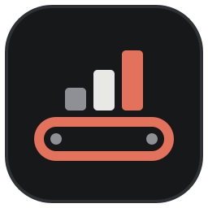
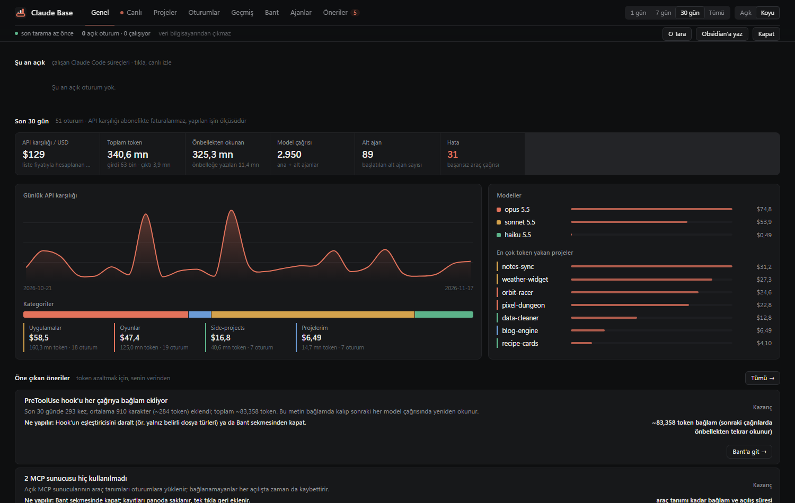
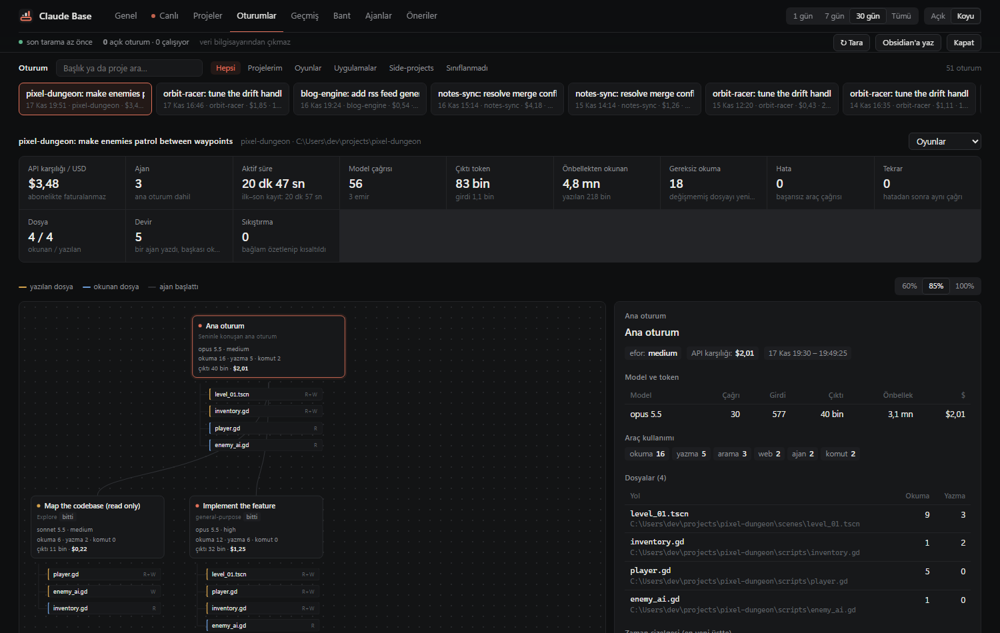
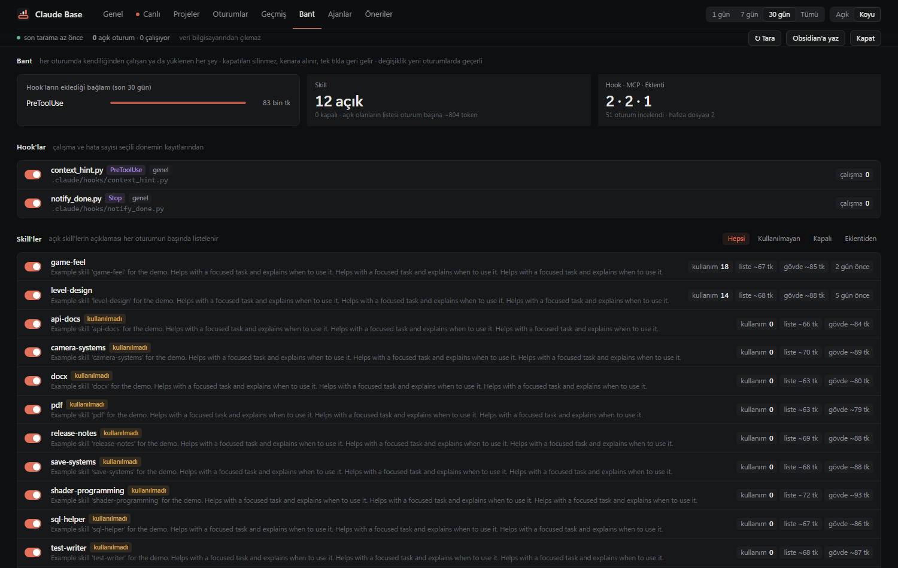
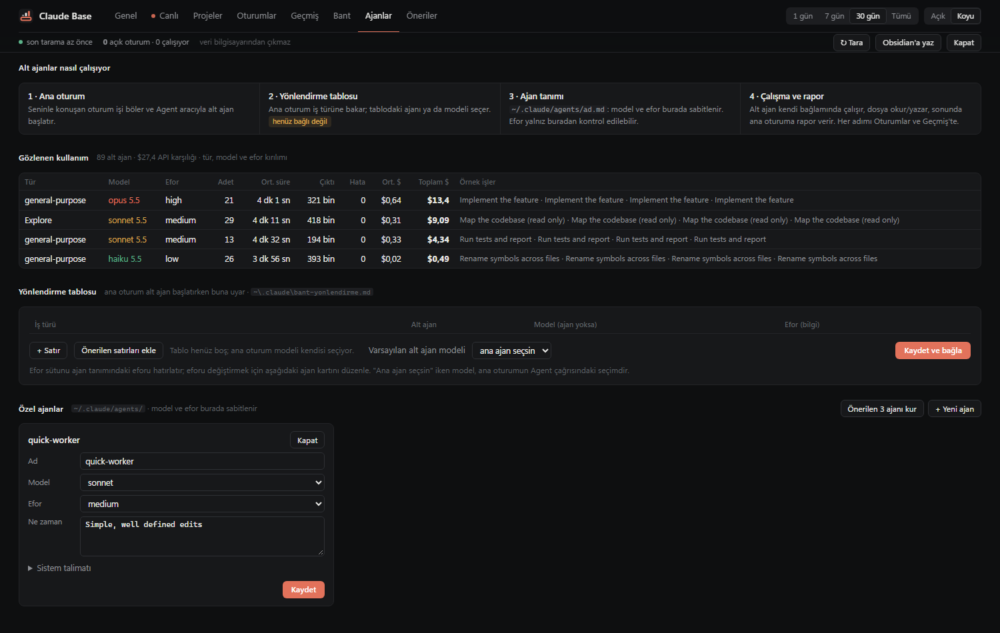
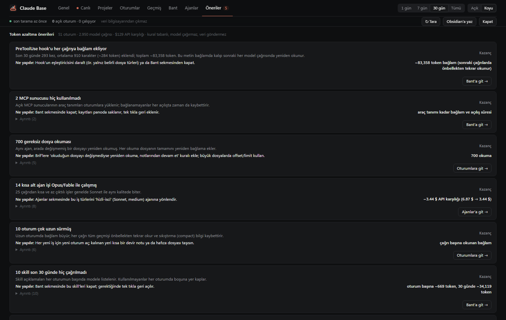
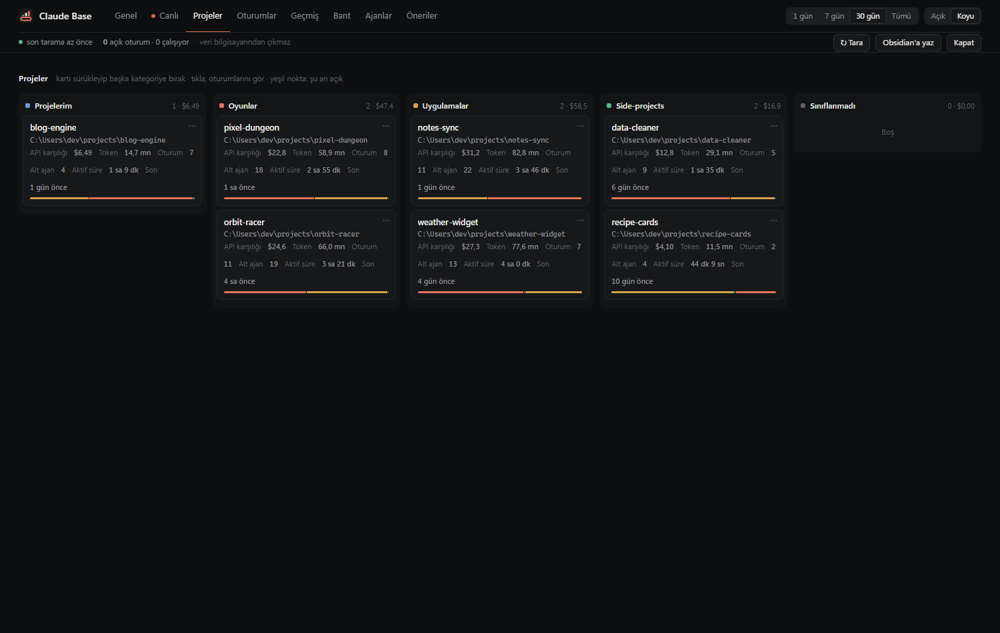
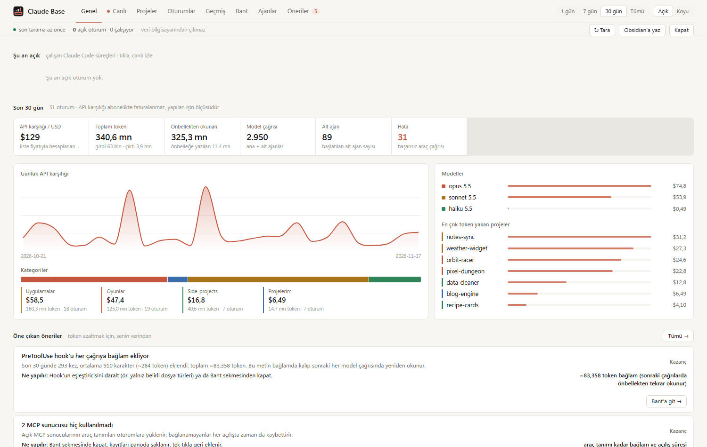

<p align="center"></p>

<h1 align="center">Claude Base</h1>

<p align="center">A local dashboard for your Claude Code activity: tokens, sessions, sub-agents, skills, hooks and MCP servers on one screen.<br>
Claude Code etkinliğin için yerel bir pano: token, oturum, alt ajan, skill, hook ve MCP sunucuları tek ekranda.</p>

<p align="center"><a href="#english">English</a> · <a href="#türkçe">Türkçe</a></p>



> The screenshots use generated demo data (`demo/demo_veri.py`), not real sessions.
> Ekran görüntülerindeki veriler uydurmadır (`demo/demo_veri.py`), gerçek oturumlar değildir.

---

## English

Claude Base reads the session logs Claude Code already keeps on your computer and shows where your tokens go:
which project is open, which one burns the most, how sub-agents behave, which files they hand to each other,
and what you can switch off to save context.

**Fully local.** It listens only on `127.0.0.1`, makes no outbound requests, loads no external fonts or
libraries and never calls a model. Every number comes from the files on your machine.

> The interface is in Turkish for now. The tab names are translated below.

### Tabs

| Tab | What it shows |
|---|---|
| Genel (Overview) | Open sessions, period totals, daily API-equivalent cost, category and model breakdown, top projects |
| Canlı (Live) | Live flow of reads, writes, agent launches and hand-offs inside an open session |
| Projeler (Projects) | Projects grouped by category; drag a card to re-categorise it |
| Oturumlar (Sessions) | Per-session metrics, agent and file graph, agent details, timeline |
| Geçmiş (History) | Each prompt followed by what the agents did, step by step |
| Bant (Loadout) | Turn skills, hooks, MCP servers, plugins and memory files on or off; usage and context cost |
| Ajanlar (Agents) | Observed sub-agent usage, a routing table, custom agent definitions (model and effort) |
| Öneriler (Suggestions) | Token-saving suggestions based on your own data |

| | |
|---|---|
|  |  |
|  |  |
|  |  |

### Run

Requires Python 3.11+ (standard library only) and, on Windows, Microsoft Edge for the app window.

```
python server.py
```

The dashboard opens in its own window at `http://127.0.0.1:4317/`. Use `--tarayicisiz` to start without a window.
On Windows you can also double-click `Claude Base.cmd`.

Build a single `Claude Base.exe` (needs PyInstaller and Pillow):

```
python paketle.py
```

### Settings

Personal settings live in `veri/ayarlar.json`, which is git-ignored. Copy `ayarlar.ornek.json` there to start.
All fields are optional:

| Field | Meaning |
|---|---|
| `kaplar` | Folders whose first sub-folder is treated as a project name |
| `projeler` | `project name → category` (also written when you drag a card) |
| `obsidian_kasa` | Path of an Obsidian vault; enables the "Obsidian'a yaz" button |
| `obsidian_sonra` | Command to run in the vault after a note is written |
| `atla_proje` | Project folders to skip while scanning |
| `ek_hafiza` | Extra `CLAUDE.md` / `AGENTS.md` files to list in the Loadout tab |

Environment variables: `CLAUDE_BASE_HOME` (where to look for `.claude`), `CLAUDE_BASE_DATA` (cache folder),
`CLAUDE_BASE_PORT`, `CLAUDE_BASE_HIDE_HOME=1` (shows `~` instead of your home path, handy for screenshots).

### What it reads and writes

Reads only: `~/.claude/projects/**.jsonl`, `~/.claude/sessions/*.json`, `~/.claude/settings.json`,
`~/.claude.json`, `~/.claude/skills`, `~/.claude/agents` and plugin records.

Writes only when you press a button, and backs the file up first (`veri/yedekler/`): `settings.json` (hooks,
plugins), `claude mcp` (MCP servers), moves a skill folder to `~/.claude/bant-kapali/`, agent files in
`~/.claude/agents/`, and an optional routing note imported from `~/.claude/CLAUDE.md`. Nothing is deleted.

### How numbers are calculated

- **API equivalent:** list prices in `config.py → FIYATLAR`. Subscriptions are not billed this way; it is a
  measure of work. Cache writes count as input ×1.25 (5 min) or ×2 (1 h).
- **Skill and memory tokens:** estimated from character count (shown with `~`).
- **Redundant read:** the same agent reading the same part of a file that has not changed since.
- **Hand-off:** one agent reads a file that another agent wrote.

### Demo data

```
python demo/demo_veri.py   # generate a fake ~/.claude under demo/ev
python demo/ekran.py       # regenerate the screenshots in docs/screenshots
```

---

## Türkçe

Claude Base, Claude Code'un zaten bilgisayarında tuttuğu oturum kayıtlarını okur ve token'ların nereye gittiğini
gösterir: hangi proje açık, hangisi en çok yakıyor, alt ajanlar nasıl çalışıyor, birbirlerine hangi dosyaları
devrediyor, neyi kapatarak bağlam kazanırsın.

**Tamamen yerel.** Yalnız `127.0.0.1` adresinde dinler; dışarıya istek atmaz, dış font ya da kütüphane yüklemez,
model çağırmaz. Bütün sayılar bilgisayarındaki dosyalardan gelir.

### Sekmeler

| Sekme | Ne gösterir |
|---|---|
| Genel | Açık oturumlar, dönem toplamları, günlük API karşılığı, kategori ve model kırılımı, en çok yakan projeler |
| Canlı | Açık bir oturumda ajanlar ve dosyalar arasındaki anlık akış (okuma, yazma, ajan başlatma, devir) |
| Projeler | Kategorilere göre projeler; kartı sürükleyerek kategori değiştir |
| Oturumlar | Oturum metrikleri, ajan–dosya grafiği, ajan ayrıntısı, zaman çizelgesi |
| Geçmiş | Her emir ve ardından ajanların adım adım yaptıkları |
| Bant | Skill, hook, MCP, eklenti ve hafıza dosyalarını aç/kapat; kullanım ve bağlam yükü |
| Ajanlar | Gözlenen alt ajan kullanımı, yönlendirme tablosu, özel ajan tanımları (model ve efor) |
| Öneriler | Senin verine dayanan token azaltma önerileri |

### Çalıştırma

Python 3.11+ (yalnız standart kütüphane) ve Windows'ta pencere için Microsoft Edge gerekir.

```
python server.py
```

Pano kendi penceresinde `http://127.0.0.1:4317/` adresinde açılır. Pencere açmadan başlatmak için `--tarayicisiz`.
Windows'ta `Claude Base.cmd` dosyasına çift tıklamak da yeter.

Tek dosyalık `Claude Base.exe` üretmek için (PyInstaller ve Pillow gerekir):

```
python paketle.py
```

### Ayarlar

Kişisel ayarlar git dışındaki `veri/ayarlar.json` dosyasında durur. Başlamak için `ayarlar.ornek.json` dosyasını
oraya kopyala. Bütün alanlar isteğe bağlıdır:

| Alan | Anlamı |
|---|---|
| `kaplar` | İlk alt klasörü proje adı sayılan klasörler |
| `projeler` | `proje adı → kategori` (kart sürükleyince de yazılır) |
| `obsidian_kasa` | Obsidian kasasının yolu; "Obsidian'a yaz" düğmesini açar |
| `obsidian_sonra` | Not yazıldıktan sonra kasada çalışacak komut |
| `atla_proje` | Taramada atlanacak proje klasörleri |
| `ek_hafiza` | Bant sekmesinde gösterilecek ek `CLAUDE.md` / `AGENTS.md` dosyaları |

Ortam değişkenleri: `CLAUDE_BASE_HOME` (`.claude` klasörünün arandığı yer), `CLAUDE_BASE_DATA` (önbellek klasörü),
`CLAUDE_BASE_PORT`, `CLAUDE_BASE_HIDE_HOME=1` (ev klasörünün yolu yerine `~` yazar; ekran görüntüsü için).

### Okuduğu ve yazdığı yerler

Yalnız okur: `~/.claude/projects/**.jsonl`, `~/.claude/sessions/*.json`, `~/.claude/settings.json`,
`~/.claude.json`, `~/.claude/skills`, `~/.claude/agents` ve eklenti kayıtları.

Yalnız sen düğmeye bastığında yazar ve önce yedekler (`veri/yedekler/`): `settings.json` (hook, eklenti),
`claude mcp` (MCP), skill klasörünü `~/.claude/bant-kapali/` altına taşıma, `~/.claude/agents/` içindeki ajan
dosyaları ve `~/.claude/CLAUDE.md` içinden içe aktarılan isteğe bağlı yönlendirme notu. Hiçbir şey silinmez.

### Hesaplanan değerler

- **API karşılığı:** `config.py → FIYATLAR` liste fiyatlarıyla hesaplanır; abonelikte böyle faturalanmaz, yapılan
  işin ölçüsüdür. Önbelleğe yazma 5 dk için girdi ×1,25, 1 sa için ×2 sayılır.
- **Skill ve hafıza token'ı:** karakter sayısından tahmin (`~` ile gösterilir).
- **Gereksiz okuma:** aynı ajanın, arada değişmemiş bir dosyanın aynı bölümünü yeniden okuması.
- **Devir:** bir ajanın yazdığı dosyayı başka bir ajanın okuması.

### Demo verisi

```
python demo/demo_veri.py   # demo/ev altında uydurma bir ~/.claude üretir
python demo/ekran.py       # docs/screenshots altındaki görüntüleri yeniden alır
```
